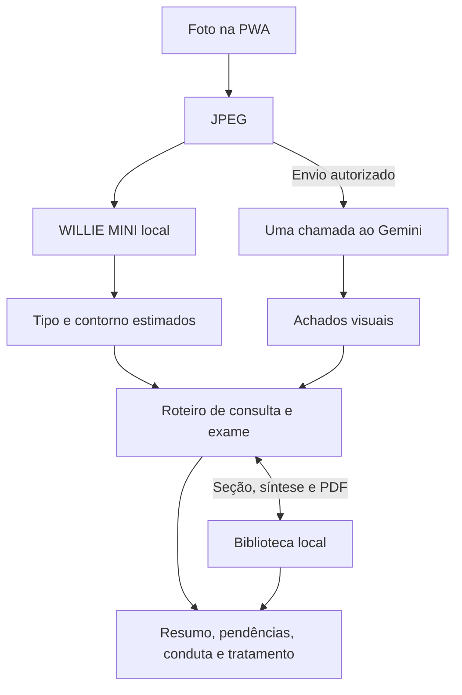

# Arquitetura e fluxo de dados

## Foto

O WILLIE usa um checkpoint oficial do MINI com os decodificadores de classificação e segmentação. A estimativa de contorno usa a máscara do modelo e pode ser ocultada na tela. As classes são `diabetic`, `pressure`, `surgical`, `venous` e `no_wound`. O Gemini recebe um esquema JSON para achados visuais, qualidade e descrição da foto. Uma falha em um provedor deixa os resultados do outro acessíveis.

## Exame e resumo

O profissional pode corrigir a etiologia e mudar o roteiro. Os achados visuais abrem ou priorizam perguntas, como extensão do eritema ou presença de secreção purulenta. Cada sugestão visual tem revisão própria. Os campos clínicos registram as informações usadas para a hipótese, o estadiamento quando aplicável, a avaliação de infecção e a seleção dos tópicos de tratamento.

O servidor seleciona as orientações e evidências a partir do contexto registrado, com vínculo por assunto e com busca textual para as fontes complementares. O resumo indica os dados que ainda faltam para decidir opções como descarga de pressão ou compressão. As recomendações e as sínteses são vinculadas à publicação, como apoio à avaliação e à discussão com a equipe.

## Biblioteca

`web/data/protocolos.mjs` reúne os trechos de avaliação. `web/data/treatment.mjs` reúne as sínteses de tratamento e estudos. Em `guidance`, use o identificador da pergunta para vincular a orientação. Para cadastrar um PDF local, indique `document` e, quando útil, `page` no registro. O mapa `web/data/documents.mjs` contém as origens dos PDFs baixados pelo script.

A biblioteca permite busca nos títulos, nas sínteses e nos termos indexados. O PDF abre no visualizador do navegador. Os arquivos integrais são baixados das origens para a instalação local, e cada entrada preserva o link original. As sínteses em português podem ser revisadas e complementadas com o protocolo do serviço.

A PWA armazena em cache a interface e o catálogo. A foto, o exame e as respostas da API ficam fora do cache. Ao alterar o frontend, atualize as URLs de recursos em `web/index.html` e a versão correspondente em `web/sw.js`.
