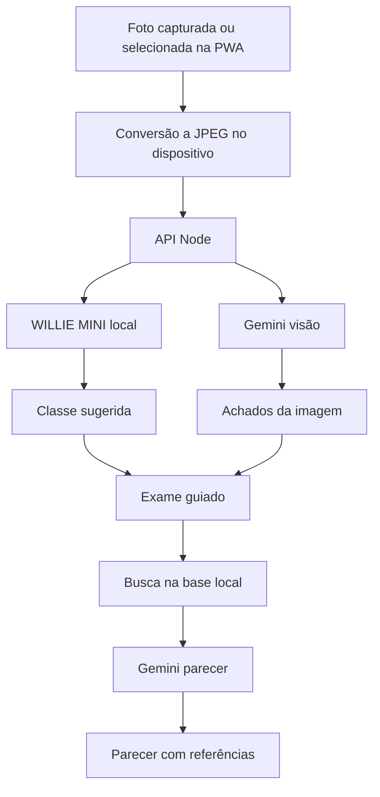

# Arquitetura e fluxo de dados

## Imagem e exame

A PWA converte a foto para JPEG com dimensão máxima de 1.536 pixels, removendo metadados do arquivo original durante a conversão. O servidor recebe os mesmos bytes que envia ao WILLIE e ao Gemini de visão. O classificador roda com os pesos MINI fold 0 dos autores e usa a ordem de classes do notebook oficial. Só o cabeçote de classificação é executado, e a resposta pública do serviço contém apenas `class`.

O modelo de visão devolve qualidade, achados visuais em categorias definidas e uma descrição. Vermelhidão e material amarelado geram destaque para perguntas de extensão do eritema e secreção no exame. As respostas clínicas registram quando um achado ficou sem avaliação. A ausência de lesão pode ser confirmada no exame mesmo se o modelo sugerir uma ferida. Uma pele íntegra com lesão por pressão ainda pode ser reconhecida clinicamente.

## Recuperação e parecer

A busca lexical pontua trechos locais por correspondência de termos e dá peso adicional às palavras-chave. A etiologia clínica registrada orienta o filtro temático. Na falta dessa informação, a sugestão do WILLIE pode direcionar a busca, e a hipótese permanece indeterminada até haver dados clínicos. Com a base inicial pequena, a recuperação roda em memória e dispensa um banco vetorial. A função `retrieve` recebe um acervo de trechos e pode ser substituída por um índice maior.

O Gemini do parecer recebe a classe do WILLIE, os achados estruturados, as respostas, os trechos encontrados e os critérios calculados pelo servidor. O texto descritivo da foto e o JPEG ficam fora dessa segunda chamada. A API verifica cada ID citado contra os trechos recuperados. O texto do modelo é exibido como sugestão preliminar para revisão humana.

O estágio de lesão por pressão exige confirmação do contexto e dos tecidos no exame. A escala IWGDF/IDSA é usada para o pé em pessoa com diabetes quando há dados compatíveis com seus critérios. As demais situações mostram a gravidade como indeterminada quando a base não oferece uma escala aplicável. O alerta imediato usa respostas clínicas e pode ser exibido mesmo se o parecer estiver indisponível.

## Manter a base

Cada trecho em `web/data/protocolos.mjs` tem `id` único, `type`, `organization`, `year`, `title`, `section`, `url` HTTPS, síntese em `text` e uma lista `tags`. A biblioteca e a recuperação consultam a mesma base. Registre protocolos institucionais revisados por seção, mantenha os IDs estáveis e atualize a versão do cache em `web/sw.js` ao mudar os arquivos da interface.

A base inicial contém sínteses de seções selecionadas, com ligações para consulta do conteúdo integral. [Anvisa, lesão por pressão](https://www.gov.br/anvisa/pt-br/centraisdeconteudo/publicacoes/servicosdesaude/notas-tecnicas/notas-tecnicas-vigentes/nota-tecnica-gvims-ggtes-anvisa-no-05-2023-praticas-de-seguranca-do-paciente-em-servicos-de-saude-prevencao-de-lesao-por-pressao/) · [IWGDF/IDSA, infecção do pé relacionada ao diabetes](https://doi.org/10.1093/cid/ciad527) · [NICE NG125, sítio cirúrgico](https://www.nice.org.uk/guidance/ng125/chapter/recommendations) · [NICE NG152, úlcera de perna](https://www.nice.org.uk/guidance/ng152/chapter/recommendations)
