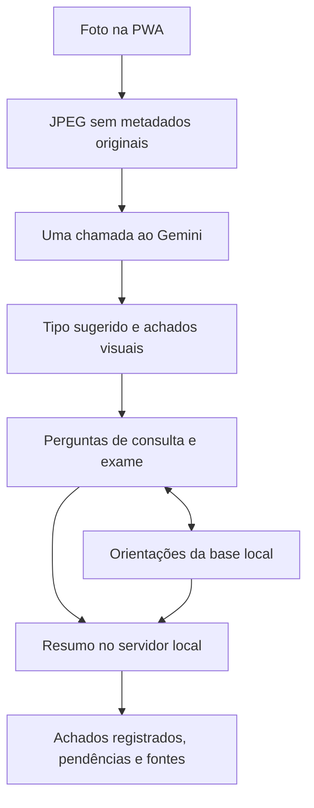

# Arquitetura e fluxo de dados

## Análise da foto

A PWA converte a foto para JPEG de até 1.536 pixels por lado e a envia ao servidor após confirmação de autorização. O servidor faz um pedido ao Gemini com um esquema JSON. O modelo devolve o tipo sugerido, a qualidade da imagem e os achados visuais. As classes são `diabetic`, `pressure`, `surgical`, `venous` e `no_wound`. Uma imagem inconclusiva pode voltar com tipo indeterminado e abrir o roteiro geral. Ao voltar à foto na mesma ficha, a PWA reutiliza os achados em memória.

## Consulta e exame

O formulário começa com perguntas comuns de história, como presença de diabetes, febre e sinais de piora. A sugestão da foto seleciona as perguntas específicas. O contexto indicado pelo profissional passa a orientar esse roteiro assim que é registrado. Os achados visuais dão prioridade a perguntas do exame, como extensão da vermelhidão ou secreção. A confirmação clínica permite registrar alterações de pele mesmo quando a foto retorna sem ferida visível.

## Orientações e resumo

A orientação de cada pergunta é buscada pelo identificador do campo e pelo contexto vigente. O navegador dá preferência à referência específica e usa uma referência geral quando apropriado. As orientações são sínteses com a seção e um link para o texto integral.

O servidor consulta a mesma base e monta o resumo das respostas confirmadas, pendências, hipóteses e referências. O contexto, os tecidos e a profundidade registrados orientam o estágio da lesão por pressão. A escala IWGDF/IDSA exige confirmação de que a lesão está no pé de uma pessoa com diabetes e dos critérios clínicos necessários. Em caso de dados insuficientes, o resumo mantém a incerteza e mostra a fonte relacionada à pendência.

## Manter a base

Edite `web/data/protocolos.mjs` para incluir novas sínteses ou protocolos locais revisados. Use identificadores estáveis e links HTTPS. Em `guidance`, a chave é o identificador da pergunta e o valor é a orientação correspondente. A função `retrieve` procura termos na base para o resumo e `guidanceFor` faz a consulta específica na ficha.

Atualize a versão do cache em `web/sw.js` e use o mesmo número na URL dos arquivos de interface em `web/index.html` e no shell do service worker quando alterar o frontend. As URLs versionadas permitem atualizar a ficha instalada e carregar o esquema correspondente ao servidor.

Fontes iniciais. [Anvisa, lesão por pressão](https://www.gov.br/anvisa/pt-br/centraisdeconteudo/publicacoes/servicosdesaude/notas-tecnicas/notas-tecnicas-vigentes/nota-tecnica-gvims-ggtes-anvisa-no-05-2023-praticas-de-seguranca-do-paciente-em-servicos-de-saude-prevencao-de-lesao-por-pressao/) · [IWGDF/IDSA, infecção do pé relacionada ao diabetes](https://doi.org/10.1093/cid/ciad527) · [NICE NG125, sítio cirúrgico](https://www.nice.org.uk/guidance/ng125/chapter/recommendations) · [NICE NG152, úlcera de perna](https://www.nice.org.uk/guidance/ng152/chapter/recommendations)
